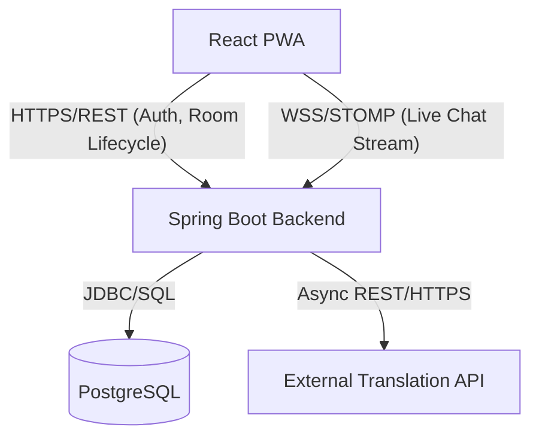
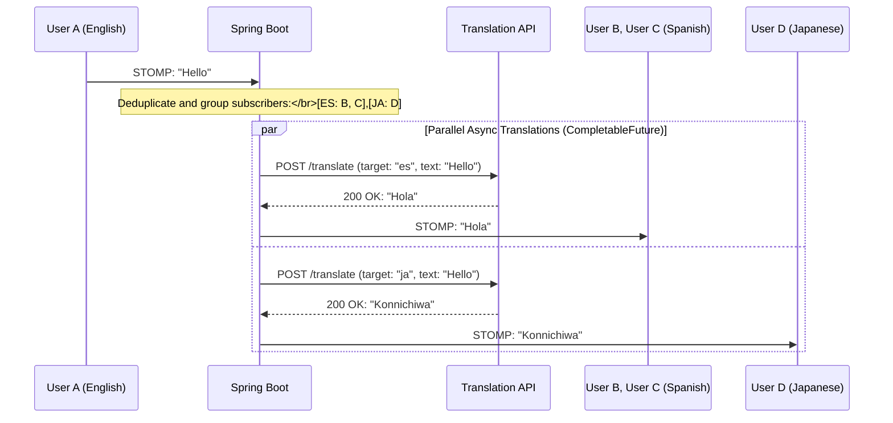
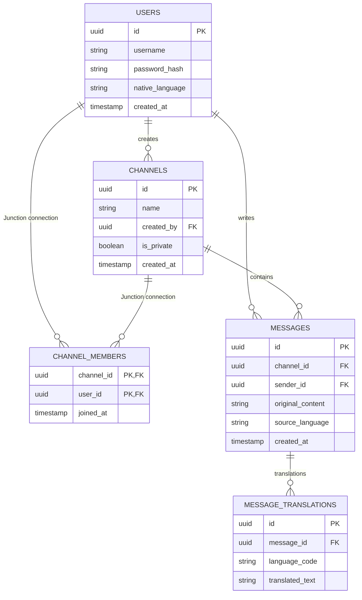

# RFC-001: LingoDrop System Overview & Architecture Baseline

## 1. Context & Motivation
LingoDrop is a real-time, cross-lingual chat platform designed to eliminate language barriers. Users send messages in their native tongue, and the system dynamically intercepts, translates, and distributes localized payloads so all recipients read the message in their preferred language. The architectural challenge centers on real-time fan-out efficiency: preventing $O(N)$ translation overhead by grouping subscribers by language and dispatching asynchronous, concurrent translation requests without blocking the primary chat event loop.

## 2. System Container Architecture

## 3. Real-Time Translation Fan-Out Lifecycle

## 4. Persistent Relational Data Model

## 5. Architectural Decisions & Operational Trade-Offs
* **Repository Layout:** Monorepo architecture (`/server`, `/client`, `/docs`) to maintain unified versioning, atomic commits, and centralized documentation.
* **Storage Boundaries:** 
  * *Casual Mode:* Entirely in-memory via `ConcurrentHashMap` with TTL expiration and connection-drop listeners to eliminate database write amplification from ephemeral sessions.
  * *Ranked Mode:* Persisted in PostgreSQL using a normalized schema with 1-to-N message translations to support zero-schema-drift localized chat histories.
* **Concurrency Model:** Asynchronous non-blocking fan-out using Java `CompletableFuture` combined with HTTP connection pooling to prevent third-party API latency from bottlenecking the real-time STOMP message broker.
* **Git Conventions:** GitHub Flow with Conventional Commits (`feat:`, `fix:`, `docs:`, `test:`, `refactor:`) using the imperative mood.